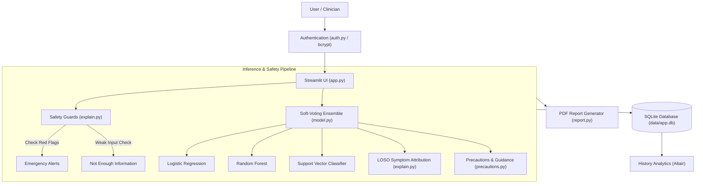

# Multi-Disease Detection & Decision Support System

An intelligent, clinically-informed multi-disease risk assessment application built with Streamlit and scikit-learn. The system evaluates 24 binary symptom indicators to provide calibrated soft-voting ensemble predictions across 10 disease categories, complete with explainability attributions, safety guards, emergency red-flag triggers, and downloadable clinical PDF reports.

---

## 🌟 Key Features

- **Tri-Model Soft Voting Ensemble:** Combines Logistic Regression, Random Forest, and Support Vector Classifier (SVC) with calibrated soft-voting probability averaging.
- **Explainable Predictions:**
  - **Leave-One-Symptom-Out (LOSO) Attribution:** Dynamically identifies and ranks which specific symptoms drove the top prediction based on marginal probability drops.
  - **Differential Candidate Visualizations:** Real-time horizontal bar charts (Altair) displaying the top 3 disease candidates with confidence levels.
- **Clinical Safety Guards:**
  - **Weak-Input Guard:** Halts predictions and displays a safe guidance message ("Not enough information") if fewer than 2 symptoms are reported or ensemble confidence falls below 40%.
  - **Emergency Red-Flag Rules:** Hardcoded critical symptom rules (e.g., chest pain with shortness of breath or diaphoresis) trigger prominent emergency medical alerts regardless of model confidence.
- **Robust Authentication & Storage:**
  - Parameterized SQLite backend (`data/app.db`) isolating assessments per authenticated user.
  - Salted `bcrypt` password hashing with minimum length enforcement (>= 8 characters).
  - Secure CSV export via direct browser download without server-side file pollution.
- **Actionable Precautions & PDF Export:**
  - Standardized general safety guidance and "When to Seek Care" triggers for all 10 diseases.
  - Downloadable comprehensive clinical PDF summary report (`fpdf2`).
- **Interactive History Analytics:**
  - In-app longitudinal analytics illustrating most frequent predictions and reported symptoms.

---

## 🏛️ System Architecture



---

## 🔬 Dataset Hygiene & Rigorous Evaluation

The bundled dataset (`pro_disease_dataset.csv`) underwent rigorous cleaning to eliminate synthetic data artifacts:
- **Exact Duplicates Removed:** 520 rows (26.0%) dropped.
- **Conflicting Patterns Removed:** 25 symptom patterns mapped to multiple distinct diseases (51 rows) detected and removed.
- **Data Leakage Prevention:** Asserted 0% feature overlap between training (80%) and hold-out test (20%) partitions.

For complete details on the synthetic data characteristics and external validation scripts, refer to [`DATASET.md`](DATASET.md).

---

## 📊 Measured Model Performance

Real measured numbers extracted from `models/metrics.json` on the cleaned dataset (N=1,429):

| Model | Hold-out Accuracy | Hold-out Macro F1 | 5-Fold CV Accuracy (Mean ± Std) | 5-Fold CV Macro F1 (Mean ± Std) |
| :--- | :---: | :---: | :---: | :---: |
| **Logistic Regression** | 0.9301 (93.0%) | 0.9306 | 0.9239 ± 0.0090 | 0.9241 ± 0.0088 |
| **Random Forest** | 0.9650 (96.5%) | 0.9658 | 0.9484 ± 0.0069 | 0.9483 ± 0.0070 |
| **SVC** | 0.9650 (96.5%) | 0.9660 | 0.9484 ± 0.0070 | 0.9485 ± 0.0070 |
| **Ensemble (Soft-Voting)** | **0.9580 (95.8%)** | **0.9592** | **0.9449 ± 0.0044** | **0.9450 ± 0.0043** |

*Evaluation methodology: 5-Fold Stratified Cross-Validation on training split, evaluated on an independent 20% stratified hold-out test set with zero feature leakage.*

---

## 🚀 Setup & Installation

### 1. Clone the Repository
```bash
git clone https://github.com/Manojkumar1121/multi_disease_detection.git
cd multi_disease_detection
```

### 2. Install Dependencies
```bash
pip install -r requirements.txt
```

### 3. Run Application
```bash
streamlit run app.py
```

---

## 🛠️ Model Training & Testing

### Train Models
To retrain models from scratch and regenerate `models/metrics.json`:
```bash
python train.py --force
```

### Run Automated PyTest Suite
Run the full automated test suite verifying data cleaning, leakage prevention, soft-voting probabilities, safety guards, auth round-trips, and precautions:
```bash
pytest
```

### Evaluate On External Dataset
Evaluate an external CSV dataset:
```bash
python evaluate_external.py path/to/dataset.csv
```

---

## 📸 Screenshots

*(Placeholder section for application interface and decision-support views)*

- **Dashboard & Differential View:** `[Add screenshot of prediction dashboard and Altair top 3 candidates]`
- **LOSO Feature Attribution:** `[Add screenshot of leave-one-symptom-out impact bar chart]`
- **Emergency Red-Flag Alert:** `[Add screenshot of critical cardiac alert]`
- **History & Analytics:** `[Add screenshot of assessment history and trends]`

---

## ⚖️ Limitations & Medical Ethics

> [!WARNING]
> **Clinical Decision Support Only — Not a Medical Diagnosis**
>
> 1. **Educational & Prototype Use:** This tool is designed strictly as an engineering research demonstrator and educational decision-support prototype. It is **not** an FDA-cleared diagnostic device.
> 2. **Synthetic Data Context:** As documented in `DATASET.md`, the dataset exhibits synthetic characteristics with near-uniform disease distributions. Real-world epidemiology exhibits disparate prevalence rates and comorbidities.
> 3. **Clinician In The Loop:** Automated statistical models cannot replace certified clinicians, physical exams, imaging, or laboratory diagnostic bloodwork.
> 4. **Emergency Care:** If experiencing severe symptoms (acute chest pain, respiratory arrest, loss of consciousness), seek immediate emergency medical care.

---

## 📄 License

This project is licensed under the MIT License - see the [LICENSE](LICENSE) file for details.
